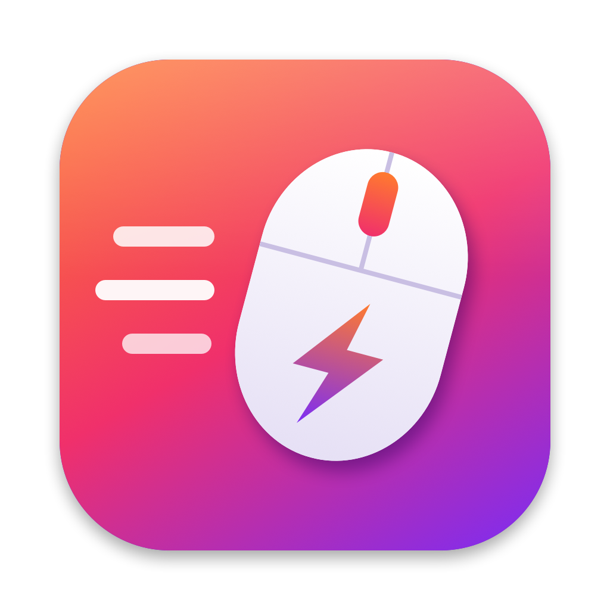

<p align="center">
  
</p>

<h1 align="center">MouseOnRoids</h1>

<p align="center"><a href="README.md">English</a> · <b>Deutsch</b></p>

<p align="center">
  Damit sich eine normale (Nicht-Apple-)Maus am Mac richtig gut anfühlt.<br>
  Sanftes, kontrolliertes Scrollen · Autoscroll mit der mittleren Maustaste wie unter Windows · Ordner im Finder per Mittelklick als Tab öffnen
</p>

---

macOS ist auf Trackpad und Magic Mouse ausgelegt. Mit einer normalen Maus wird jede Raste am Mausrad
stark beschleunigt – ein schneller Dreh und die Seite fliegt davon. MouseOnRoids ist eine kleine native
App für die Menüleiste, die das behebt und die Funktionen der mittleren Maustaste nachrüstet, die man
von Windows kennt.

## Funktionen

- **Sanftes Scrollen** – jede Raste scrollt eine feste, einstellbare Strecke mit weicher Animation statt
  der sprunghaften Beschleunigung von macOS. Optional eine sanfte Beschleunigung bei schnellem Drehen.
- **Autoscroll mit der mittleren Maustaste** – wie unter Windows: mittlere Taste drücken und die Maus
  bewegen, die Seite scrollt in diese Richtung, umso schneller, je weiter du dich entfernst. Kurz klicken
  zum Starten und erneut klicken zum Beenden – oder gedrückt halten und loslassen.
- **Links und Tabs funktionieren weiter** – Mittelklick auf einen Link öffnet ihn weiterhin in einem
  neuen Tab, Mittelklick auf einen Browser-Tab schließt ihn.
- **Finder: Ordner in neuem Tab öffnen** per Mittelklick.
- **Trackpad und Magic Mouse bleiben unberührt** – nur klassische Mausrad-Ereignisse werden verändert.
- Richtung nur für die Maus umkehren, Shift + Mausrad für waagerechtes Scrollen, Ausnahmen pro App,
  Start bei Anmeldung, Testbereich im Einstellungsfenster, einfarbiges oder farbiges Menüleisten-Symbol.
- Keine Abhängigkeiten, kein Netzwerkzugriff, keine Datensammlung. Ca. 1 MB.

## Installation

1. `MouseOnRoids-x.y.zip` von der Seite [Releases](../../releases) herunterladen und entpacken.
2. **MouseOnRoids.app** in den Ordner *Programme* ziehen.
3. Die App ist nicht von Apple beglaubigt, deshalb braucht der erste Start einen Extra-Schritt:
   **Rechtsklick auf die App → Öffnen → Öffnen**.
   (Oder im Terminal: `xattr -dr com.apple.quarantine /Applications/MouseOnRoids.app`.)
4. MouseOnRoids unter **Systemeinstellungen → Datenschutz & Sicherheit → Bedienungshilfen** erlauben.
   Diese Berechtigung ist nötig, um Mausrad- und Tasten-Ereignisse lesen und anpassen zu können.

Benötigt macOS 13 Ventura oder neuer. Läuft nativ auf Intel und Apple Silicon.

## Bedienung

Auf das Maus-Symbol in der Menüleiste klicken → **Einstellungen…**.
Die App gibt es auf Deutsch und Englisch, sie richtet sich nach der Systemsprache.

| Einstellung | Wirkung |
| --- | --- |
| Scroll-Distanz | Strecke pro Raste am Mausrad |
| Weichheit | Wie lange jedes Scrollen ausrollt |
| Beschleunigung | Mehr Strecke bei schnellem Drehen (aus = linear) |
| Mittlere Maustaste | Autoscroll an/aus, Tempo, Mittelklick auf Links/Tabs beibehalten |
| Finder | Mittelklick auf einen Ordner öffnet ihn als neuen Tab |
| Ausnahmen | Apps, in denen MouseOnRoids nichts verändert (z. B. Spiele) |
| Menüleisten-Symbol | Einfarbig (macOS-Stil) oder farbiges App-Icon |

## Selbst bauen

```bash
git clone https://github.com/cureter/MouseOnRoids.git
cd MouseOnRoids
./build.sh            # bauen und nach ~/Applications installieren
./build.sh release    # Universal-Build als ZIP in dist/
```

Es werden nur die Xcode Command Line Tools gebraucht (`xcode-select --install`), kein Xcode-Projekt.
Das Icon wird per Code gezeichnet: `swift tools/make-icon.swift Resources/icon_1024.png`.

**Tipp:** macOS bindet die Bedienungshilfen-Erlaubnis an die Signatur der App. Ad-hoc signierte Builds
bekommen jedes Mal eine neue Signatur, die Erlaubnis müsste also nach jedem Build neu erteilt werden.
Lege in der Schlüsselbundverwaltung ein selbst signiertes Codesignatur-Zertifikat an und übergib dessen
Namen mit `SIGN_IDENTITY="Mein Zertifikat" ./build.sh`, dann bleibt die Erlaubnis erhalten.

## Übersetzungen

Die Übersetzungen liegen in `Resources/<sprache>.lproj/Localizable.strings`, der englische Text ist der
Schlüssel. Für eine neue Sprache `Resources/de.lproj` z. B. nach `Resources/fr.lproj` kopieren, die rechte
Seite übersetzen, das Sprachkürzel in `Info.plist` unter `CFBundleLocalizations` ergänzen und einen
Pull Request stellen.

## Lizenz

[MIT](LICENSE)
