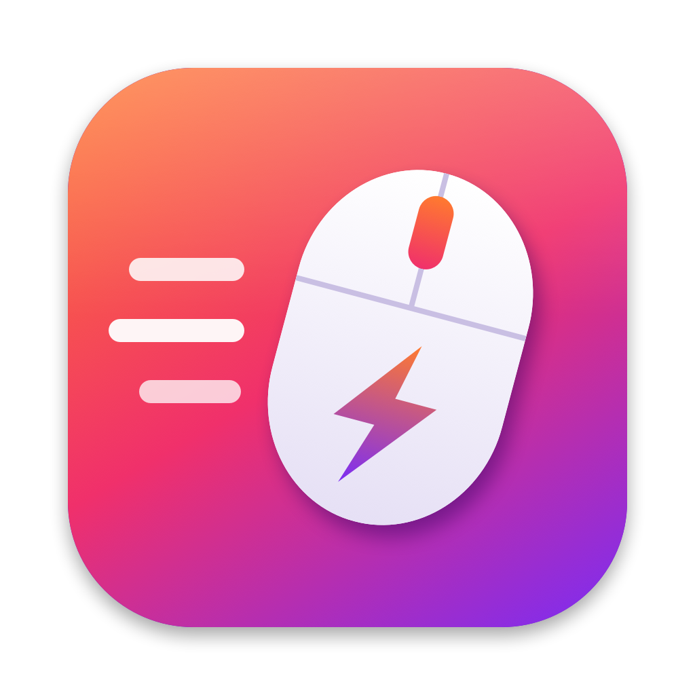

<p align="center">
  
</p>

<h1 align="center">MouseOnRoids</h1>

<p align="center"><b>English</b> · <a href="README.de.md">Deutsch</a></p>

<p align="center">
  Make a regular (non-Apple) mouse feel great on macOS.<br>
  Smooth, controllable wheel scrolling · Windows-style middle-click autoscroll · middle-click folders into Finder tabs
</p>

---

macOS is tuned for trackpads and the Magic Mouse. With an ordinary mouse, every wheel notch is
heavily accelerated, so a quick flick sends pages flying. MouseOnRoids is a tiny native menu bar
app that fixes that and adds the middle-button features you know from Windows.

## Features

- **Smooth wheel scrolling** – every notch scrolls a fixed, adjustable distance with a soft animation
  instead of macOS' jumpy acceleration. Optional, gentle acceleration when you spin the wheel fast.
- **Middle-click autoscroll** – like on Windows: press the middle button and move the mouse; the page
  scrolls in that direction, faster the further you move. Click to start / click to stop, or hold and release.
- **Links and tabs keep working** – middle-click on a link still opens it in a new tab, middle-click on a
  browser tab still closes it.
- **Finder: open folders in a new tab** with a middle click.
- **Trackpad and Magic Mouse are untouched** – only classic wheel events are changed.
- Reverse direction for the mouse only, Shift + wheel for horizontal scrolling, per-app exceptions,
  launch at login, live test area in the settings window.
- No dependencies, no network access, no data collection. ~1 MB.

## Installation

1. Download `MouseOnRoids-x.y.zip` from the [Releases](../../releases) page and unzip it.
2. Move **MouseOnRoids.app** to your *Applications* folder.
3. The app is not notarized by Apple, so the first launch needs one extra step:
   **right-click the app → Open → Open**. (Or run `xattr -dr com.apple.quarantine /Applications/MouseOnRoids.app`.)
4. Allow MouseOnRoids under **System Settings → Privacy & Security → Accessibility**.
   This permission is required to read and adjust mouse wheel and button events.

Requires macOS 13 Ventura or newer. Runs natively on Intel and Apple Silicon.

## Usage

Click the mouse icon in the menu bar → **Settings…**.
The app is available in English and German and follows your system language.

| Setting | What it does |
| --- | --- |
| Scroll distance | Distance per wheel notch |
| Smoothness | How long each scroll glides |
| Acceleration | Extra distance when spinning the wheel fast (off = linear) |
| Middle mouse button | Autoscroll on/off, speed, keep middle-click on links/tabs |
| Finder | Middle-click a folder to open it in a new tab |
| Exceptions | Apps where MouseOnRoids does nothing (e.g. games) |
| Menu bar icon | Monochrome (macOS style) or the colored app icon |

## Translations

Translations live in `Resources/<language>.lproj/Localizable.strings`; the English text is the key.
To add a language, copy `Resources/de.lproj` to e.g. `Resources/fr.lproj`, translate the right-hand
side, add the language code to `CFBundleLocalizations` in `Info.plist` and open a pull request.

## Building from source

```bash
git clone https://github.com/cureter/MouseOnRoids.git
cd MouseOnRoids
./build.sh            # builds and installs to ~/Applications
./build.sh release    # universal build, zipped into dist/
```

Only the Xcode Command Line Tools are needed (`xcode-select --install`), no Xcode project.
The icon is drawn in code: `swift tools/make-icon.swift Resources/icon_1024.png`.

**Tip:** macOS ties the Accessibility permission to the app's signature. Ad-hoc signed builds get a new
signature every time, so you would have to re-allow the app after each build. Create a self-signed
code-signing certificate in Keychain Access and pass its name via `SIGN_IDENTITY="My Cert" ./build.sh`
to keep the permission across builds.

## License

[MIT](LICENSE)
